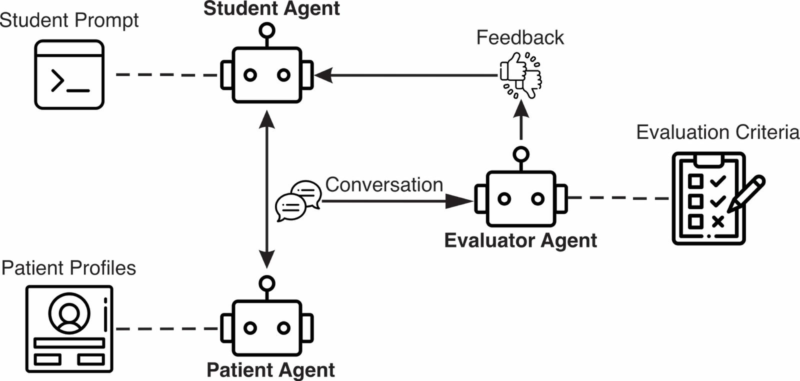

# A Multi Agent Large Language Model Framework to Simulate and Assess Counselling Skills: A Proof of Concept in Motivational Interviewing and Cognitive Behavioural Therapy

This repository provides the code and prompts used in our study evaluating a rubric-guided, multi-agent LLM system for MI and CBT training. 
It includes simulation workflows, evaluator rubrics, patient profiles, and sample results corresponding to the analyses reported in the manuscript.

# User Diagram

# Agent Descriptions

## 1. Patient Agent

### Purpose:
The Patient Agent simulates a realistic clinical patient in an interview scenario for learners practicing psychiatric interviewing skills.

### Description:

The Patient Agent roleplays a fictional patient drawn from a detailed clinical case study.

It provides authentic, context-sensitive responses to the learner’s interview questions, maintaining psychological realism, emotional tone, and diagnostic consistency.

It adapts dynamically to the interviewer’s style—responding with more or less openness, distress, defensiveness, or tangentiality depending on the interviewer’s empathy, structure, and communication style.

The patient’s dialogue reflects verbal and non-verbal clinical cues (e.g., hesitations, affective flattening, agitation, tearfulness) to help learners build diagnostic inference skills.

During the roleplay phase, the learner interacts directly with the patient in a chat-like interface, simulating a live clinical encounter.

### Core Functions:

Generate realistic patient dialogue grounded in the case formulation.

Allow interruption, redirection, or follow-up questions naturally.

Supports configurable behaviour (e.g., cooperative vs. guarded patient).

## 2. Evaluator Agent (Feedback Agent)

### Purpose:
The Evaluator Agent provides structured feedback on the learner’s interviewing performance after the roleplay session.

### Description:

It reviews the transcript of the learner’s interaction with the Patient Agent and produces feedback based on a provided clinical evaluation rubric.

It uses an instruction prompt that defines evaluation standards and scoring scales.

After delivering the evaluation, it remains active to answer learner questions or clarify rubric criteria interactively.

### Core Functions:

Parse and interpret the interview transcript.

Apply scoring rubric categories automatically.

Generate written qualitative feedback (and numerical scores if applicable).

Engage in post-feedback dialogue for reflection and learning.

## 3. Student Agent (Simulated Learner / Test Agent)

### Purpose:
Automates testing of the Learning Buddy workflow by simulating user behavior.

### Description:
The Student Agent mimics a human learner conducting an interview with the Patient Agent. It generates plausible interviewer prompts—ranging from novice-level, closed-question-heavy exchanges to more advanced, empathic responses—allowing for reproducible, automated testing of dialogue flow, logging, and evaluation accuracy. This agent ensures that both the Patient and Evaluator components can be tested end-to-end without requiring manual input.

# Installation & Running the Code

## Create virtual environment

python -m venv myenv
myenv\Scripts\activate

## Install packages

pip install streamlit langgraph langchain langchain-core langchain-openai pydantic openai elevenlabs markdown2 colorlog

## Create .env file

create a file named .env and add your api keys to the file in the following format:

OPENROUTER_API_KEY=sk...

OPENAI_API_KEY=sk...

ELEVENLABS_API_KEY=sk...

## Run app using the following command:

streamlit run streamlit_app.py

# How to Cite This Work

Kamaleddin et al., A Multi Agent Large Language Model Framework to Simulate and Assess Counselling Skills: A Proof of Concept in Motivational Interviewing and Cognitive Behavioural Therapy, 2025

# License

This project is licensed under the Apache License 2.0 (January 2004).
See the [LICENSE.txt](LICENSE.txt) file for the full text.